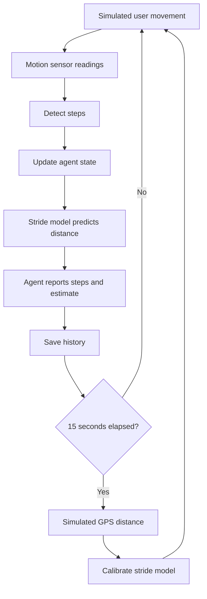

# Smartwatch Step Counter — Model-Based AI Agent

A Python simulation of a smartwatch step counter. The project demonstrates how a model-based agent uses simulated motion readings and an internal stride-length model to estimate steps and walking distance, then refines its estimate through simulated GPS calibration.

## Agent workflow

The source code follows a perceive–decide–act cycle:



## What it demonstrates

- Simulated accelerometer readings and movement detection
- Step counting from movement patterns
- Distance estimation using a modeled stride length
- Simulated GPS calibration to adjust stride estimates
- Walking, running, jogging, stairs, and stationary activity adjustments
- Step and distance graphs generated after the simulation

## Distance estimation

The basic distance calculation is:

`Distance = Steps × Estimated Stride Length`

For example, 1,000 steps with an estimated stride length of 0.78 metres gives an estimated distance of 780 metres before activity adjustment.

## Simulation output

When the simulation completes, Matplotlib displays two charts:

1. **Steps Over Time** — cumulative detected steps during the simulation.
2. **Distance Over Time** — estimated distance as the agent updates its internal model.

The runner also prints a summary containing total steps, total estimated distance, and model confidence. These charts are generated from each run's data, so the exact plots depend on the simulation.

## Technology

- Python
- NumPy
- Matplotlib

## Project structure

```text
Model-based-AI/
├── agents/
│   └── smartwatch_agent.py
├── models/
│   └── stride_model.py
├── sensors/
│   └── motion_sensor.py
├── simulators/
│   └── user_movement.py
├── runner/
│   └── simulation_runner.py
├── main.py
└── requirements.txt
```

## Run locally

1. Clone the repository:

```bash
git clone https://github.com/kura458/Model-based-AI.git
cd Model-based-AI
```

2. Create and activate a virtual environment (Windows):

```bash
python -m venv venv
venv\Scripts\activate
```

3. Install dependencies:

```bash
pip install -r requirements.txt
```

4. Run the simulation:

```bash
python main.py
```

The simulation runs for 60 seconds by default and then opens the two Matplotlib charts.

## Learning outcomes

- Model-based agent architecture
- Sensor and environment simulation
- State updates and estimation
- Distance prediction and calibration
- Data visualization with Matplotlib

## Future directions

Possible extensions include real sensor input, improved activity classification, mobile visualization, and integration with actual GPS data.

---

Academic learning project by [Kura Lemma](https://github.com/kura458).
